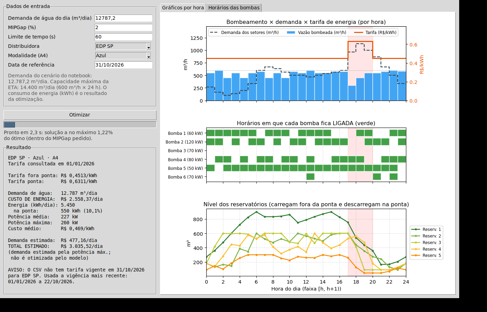

# Agendamento de bombas da ETA com Pyomo + HiGHS

Este guia descreve a implementação em Python do modelo de programação linear inteira mista (MILP) para planejar o bombeamento de uma estação de tratamento de água. O modelo usa dados tarifários da ANEEL e pode ser executado pelo terminal ou por uma interface gráfica Tkinter.

## Arquivos

- [`eta_dados.py`](eta_dados.py): parâmetros da ETA, cenário de demanda de exemplo, busca/leitura do CSV e consulta das tarifas de energia e demanda.
- [`eta_comparacao.py`](eta_comparacao.py): estimativa ilustrativa de potência hidráulica por altura manométrica hipotética.
- [`eta_pyomo.py`](eta_pyomo.py): formulação MILP em Pyomo e resolução com o solver HiGHS.
- [`eta_gui.py`](eta_gui.py): interface gráfica para configurar e visualizar um plano horário.
- [`eta_mip.py`](eta_mip.py): implementação alternativa do modelo usando python-mip com CBC.
- [`ETA_agendamento_bombas_pyomo_highs.ipynb`](ETA_agendamento_bombas_pyomo_highs.ipynb): notebook do modelo, com uma seção executável para comparar HiGHS, Gurobi e CBC.

## Instalação

Execute os comandos na raiz do repositório, no PowerShell:

```powershell
python -m venv .venv
.\.venv\Scripts\Activate.ps1
python -m pip install -r requirements.txt
python -m pip install pyomo highspy
```

O arquivo principal de dependências instala os pacotes usados pela análise e pelos notebooks. `pyomo` e `highspy` são dependências adicionais desta implementação. A interface usa Tkinter, incluído normalmente na instalação do Python para Windows.

## Abrir a interface gráfica

Com o ambiente virtual ativo e o terminal na raiz do projeto:

```powershell
python pesquisaOperacional\pyomo_highs\eta_gui.py
```

A aplicação procura automaticamente `dados/tarifas-homologadas-distribuidoras-energia-eletrica.csv`. Se não localizar o arquivo, abre uma janela para selecioná-lo. Informe a demanda diária de água, a quantidade de dias, o MIPGap, o limite de tempo, a distribuidora, a modalidade Azul/Verde e a data de referência; depois, clique em **Otimizar**. A curva de demanda se repete a cada dia, enquanto reservatórios e operação seguem continuamente pelo horizonte. Os resultados incluem energia e custo total do horizonte, médias diárias, demanda de potência estimada, horários das bombas e gráficos.



## Executar pelo terminal

O script `eta_pyomo.py` resolve o cenário padrão de um dia:

```powershell
python pesquisaOperacional\pyomo_highs\eta_pyomo.py
```

Opcionalmente, informe primeiro o caminho do CSV e depois o número de dias:

```powershell
python pesquisaOperacional\pyomo_highs\eta_pyomo.py "C:\caminho\para\tarifas.csv" 2
```

O script consulta a tarifa padrão configurada em `eta_dados.py` e imprime o número de variáveis, as tarifas, o custo, o gap, o tempo e o estado de término do solver. A execução pelo terminal usa tolerância de gap de 1% e limite de 600 segundos por padrão.

### Alternativa python-mip/CBC

Para experimentar a implementação alternativa, instale `mip` e passe o caminho do CSV como argumento:

```powershell
python -m pip install mip
python pesquisaOperacional\pyomo_highs\eta_mip.py "C:\caminho\para\tarifas.csv"
```

### Comparar solvers no notebook

Abra [`ETA_agendamento_bombas_pyomo_highs.ipynb`](ETA_agendamento_bombas_pyomo_highs.ipynb) no VS Code/Jupyter, selecione o ambiente Python do projeto e execute as células em ordem. A seção **Comparação de solvers** resolve o mesmo cenário de um dia com HiGHS, Gurobi e CBC, usando as tarifas e os parâmetros configurados no notebook. Ela mostra, para cada solver, o status, os custos diários de energia e demanda, o custo total, o gap e o tempo de solução. Indisponibilidade ou erro de um solver é indicado na própria tabela, sem impedir os resultados dos demais.

Por padrão, a comparação usa MIPGap de 1% e limite de 120 segundos por solver. HiGHS requer `pyomo` e `highspy`; CBC requer `mip`; Gurobi requer `gurobipy`, uma instalação funcional e licença válida. Instale os pacotes abertos com:

```powershell
python -m pip install pyomo highspy mip
```

O benchmark não garante que os três solvers encontrem soluções com a mesma qualidade dentro do limite de tempo. Compare o status, gap e tempo junto com os custos; resultados com erro ou sem solução viável aparecem sem valores de custo. A comparação é demonstrativa e usa as premissas e dados do notebook, não uma medição da operação da ETA.

## Como o modelo funciona

O cenário configurado representa 24 horas, seis bombas, cinco reservatórios e doze setores de consumo. O modelo escolhe quais bombas ligar e os fluxos da rede, respeitando os limites de vazão e armazenamento, a capacidade total de bombeamento da ETA e o atendimento da demanda horária. A função objetivo minimiza a soma do custo de energia (potência em kW × uma hora × tarifa horária) e de uma parcela diária estimada da tarifa mensal de demanda de potência.

A demanda é sintética: usa uma demanda-base por setor multiplicada por uma curva de verão em `eta_dados.py`. O horário de ponta é configurado como 17h, 18h e 19h. A tela permite alterar a demanda diária, mas mantém a distribuição horária proporcional à curva definida no código e a repete pelo número de dias informado. As tarifas Azul/Verde são lidas da base ANEEL para o subgrupo A4; a data de referência pode ser informada na interface. Na modalidade Verde, o modelo penaliza a maior potência horária de todo o horizonte; na Azul, os maiores valores de ponta e fora de ponta separadamente. A tarifa mensal é rateada pelos dias do horizonte (`dias/30`) como estimativa para o período otimizado. Aumentar a quantidade de dias amplia o modelo e pode aumentar significativamente o tempo de solução. O limite de demanda máxima pré-calculado pela interface é específico para um dia; em horizontes maiores, a viabilidade é decidida pelo solver.

O resultado também apresenta uma referência simulada sem otimização tarifária: ela minimiza o desvio entre bombeamento e demanda horária, respeitando a rede e os reservatórios, sem considerar os preços da energia na escolha do plano. A interface calcula o custo dessa referência e compara com o custo do plano tarifário otimizado, exibindo a diferença e o percentual relativo à referência. Como são necessárias duas execuções do solver, o tempo total pode aumentar. Isso é uma comparação entre dois cenários do modelo, não uma economia medida na instalação; o resultado depende dos dados ilustrativos, da qualidade das soluções e da simplificação da demanda de potência.

### Sensibilidade hidráulica ilustrativa

A aba **Sensibilidade hidráulica** estima a potência de entrada de cada bomba na vazão máxima cadastrada, para cenários de 30, 50 e 80 mca e rendimento global hipotético de 75%. É uma comparação matemática para estudar como vazão e altura influenciam a potência; não representa modelos ou curvas KSB, nem substitui dados da instalação. O cálculo não considera perdas de carga ou variação de eficiência e não é usado pelo solver. A otimização continua usando os parâmetros fixos de potência e vazão de `eta_dados.py`.

Para selecionar bombas reais, obtenha a altura manométrica do sistema e as curvas do fabricante para os modelos pretendidos. Até lá, os cenários não devem ser usados para dimensionamento ou operação.

## Premissas e limitações

- O CSV de tarifas deve existir em `dados/` na raiz do repositório ou ser selecionado manualmente na interface. A base não contém a UF, então a lista de distribuidoras paulistas em `eta_dados.py` é mantida manualmente.
- O horário de ponta fixo do modelo é uma premissa de exemplo; os horários reais dependem da distribuidora e da regulação aplicável.
- A configuração da ETA, a topologia, as capacidades e o perfil de demanda são dados ilustrativos, não um cadastro de instalação real.
- Tributos, bandeiras tarifárias e tarifas finais de fatura não são incluídos no custo de energia do modelo.
- A parcela de demanda é uma aproximação baseada no pico de potência do horizonte, com tarifa mensal rateada; não modela demanda contratada, ultrapassagem, regras completas de faturamento nem os demais dias do ciclo de leitura. O valor total é estimado, não uma fatura garantida.
- O MIPGap é apenas o critério de parada do solver para a distância entre a solução encontrada e o limite inferior matemático; não é uma tolerância para aceitar custo maior em troca de reduzir vazão.
- Antes de usar o agendamento em operação, valide dados, unidades, restrições, tarifas e resultados com responsáveis técnicos da instalação.
